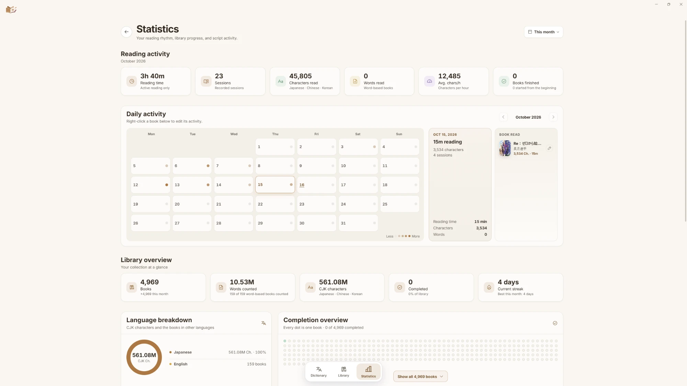
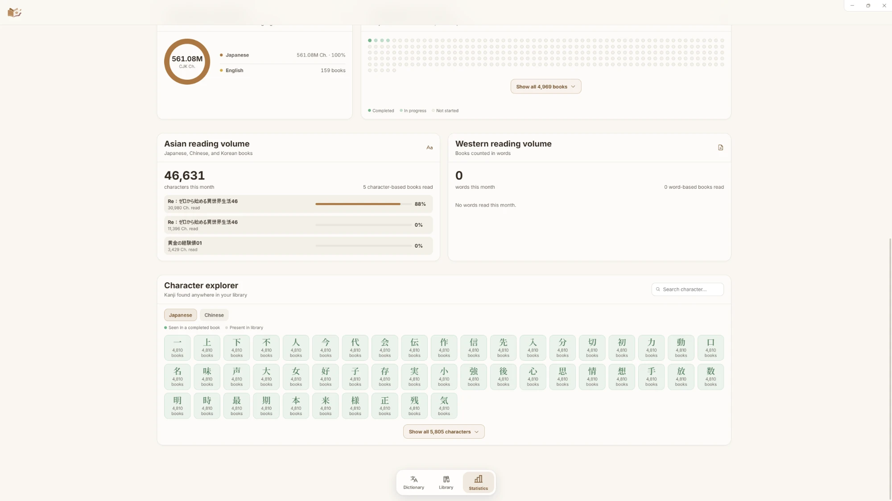
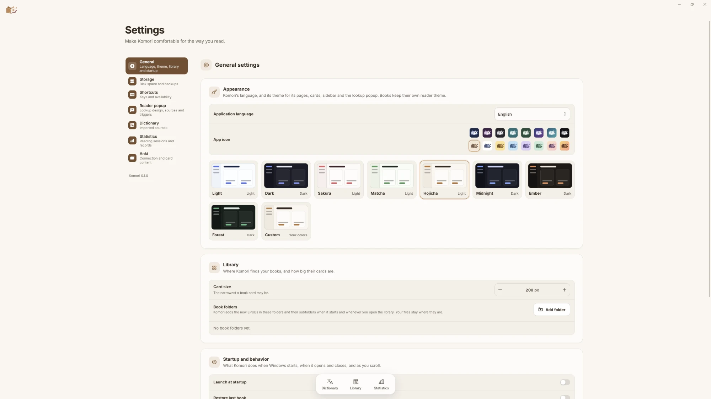

<p align="center">
  
</p>

<h1 align="center">Komori</h1>

<p align="center">
  A lightweight Windows EPUB reader for readers and language learners, with pop-up dictionary
  lookup, reading statistics and one-click Anki cards.
</p>

<p align="center">
  
  
  
  
  
  
  
  
  
  
  
  
  
  
  
  
  <br>
  <sub>Sixteen app icons to choose from in Settings.</sub>
</p>

## Screenshots

<!-- Screenshot placeholders: replace each "Screenshot to come" cell with an image of a public-domain book and the starter dictionaries, e.g. . -->

| Library                | Reader                 | Lookup popup           | Dictionary             |
| ---------------------- | ---------------------- | ---------------------- | ---------------------- |
| _(Screenshot to come)_ | _(Screenshot to come)_ | _(Screenshot to come)_ | _(Screenshot to come)_ |

| Statistics                                                           | Kanji grid                                                           | Settings                                                         |
| -------------------------------------------------------------------- | -------------------------------------------------------------------- | ---------------------------------------------------------------- |
|  |  |  |

## Features

- **Library.** Your EPUBs with real covers and progress, continue reading, grid and list
  views, search, filters, sorting, series and language groups, book folders, drag and drop
  from Explorer, and relinking of moved files. Komori reads your files where they are and
  never changes them.
- **Reader.** Continuous, semi-continuous, paginated and visual-novel modes; horizontal or
  vertical writing; detailed typography with downloadable and imported fonts; fifteen
  themes plus your own; furigana hiding; bookmarks, notes and highlights; find in book; an
  image gallery; and a configurable footer with position, clock and reading speed.
- **Lookup popup.** Look words up in the book with Shift, a shortcut, selection, click or
  hover. Deinflection, readings with furigana, pitch accent, frequency, tags, kanji cards,
  nested lookups and native word audio.
- **Dictionary.** A full dictionary page with the same results, sources in your order and
  a kanji card for single characters.
- **Statistics.** Characters (or words) read, time, speed, an activity calendar with
  editable days, library overview and a character explorer. Recording pauses while
  Komori's window is in the background.
- **Anki.** Configure once in Settings, then create a card with one click from the popup,
  with the reading, definitions, frequency, word audio and book cover. The Lapis note type
  is bundled.
- **Your data stays yours.** Automatic snapshots, backup export and import, signed
  updates you approve, and no telemetry. The interface is available in English, Japanese,
  Simplified Chinese, Korean and Brazilian Portuguese.

## Install

1. Download the latest `Komori_<version>_x64-setup.exe` from the
   [Releases](https://github.com/Yuu-4chan/komori/releases) page.
2. Run it. The installer is not code-signed, so Windows SmartScreen may warn about an
   unknown publisher; choose **More info**, then **Run anyway**.

Komori checks for new versions when it starts and asks before installing one, showing what
changed. To uninstall, use **Installed apps** in Windows Settings; the uninstaller asks
whether to delete Komori's data as well.

Komori runs on 64-bit Windows 10 and 11 and needs the Microsoft Edge WebView2 Runtime, which
Windows 11 already includes; if it is missing, the installer downloads and installs it.

## Dictionaries

On first use, **Settings > Dictionary** offers to download
a few curated, freely licensed dictionaries (Japanese–English dictionaries, a word frequency
list, a kanji dictionary and a proper-name dictionary). You can also import any dictionary
ZIP archive in the format used by popular pop-up dictionary extensions (an `index.json` in
format 2 or 3): choose **Add dictionaries** and pick one or more ZIP files. Komori copies the
entries into its own store and never changes the archive. Drag the rows to set the lookup
order. You can also use Komori freely without any dictionary.

## Privacy

Komori has no account, telemetry or analytics. Your library, reading history, notes and
dictionaries stay in `%APPDATA%\app.komori.reader` on your computer. It uses the network
only to check for updates (which you can turn off), to fetch word audio when you ask for it,
and to download starter dictionaries or Reader fonts, and talks to Anki only on your own
computer. See [docs/privacy.md](docs/privacy.md) for details.

## Build from source

### Prerequisites

| Tool                                                                                                                      | Tested version                           |
| ------------------------------------------------------------------------------------------------------------------------- | ---------------------------------------- |
| Windows 10 or 11, 64-bit                                                                                                  | Windows 11 Pro                           |
| [Visual Studio Build Tools](https://visualstudio.microsoft.com/visual-cpp-build-tools/) with Desktop development with C++ | 2022 (17.14.40)                          |
| [Microsoft Edge WebView2 Runtime](https://developer.microsoft.com/microsoft-edge/webview2/)                               | 155.0.4283.45                            |
| [Rust](https://rustup.rs/) (MSVC toolchain)                                                                               | 1.98.1 (`stable-x86_64-pc-windows-msvc`) |
| [Node.js](https://nodejs.org/)                                                                                            | 26.3.0                                   |
| [pnpm](https://pnpm.io/)                                                                                                  | 11.19.0 (pinned in `package.json`)       |

See the [Tauri prerequisites](https://v2.tauri.app/start/prerequisites/) for more on the
Windows toolchain.

### Build and run

```bash
git clone https://github.com/Yuu-4chan/komori.git
cd komori
pnpm install
pnpm tauri:dev
```

`pnpm tauri:dev` runs Komori with live reload. To build the release executable and
installer:

```bash
pnpm tauri:build
```

The executable is `src-tauri/target/release/komori.exe`, and the installer is in
`src-tauri/target/release/bundle/nsis/`. It includes `LICENSE`, `NOTICE` and
`THIRD-PARTY-NOTICES.txt`. The first release build downloads Tauri's NSIS bundling tools.

Published releases are built by the Release workflow with `pnpm tauri:release`, which also
signs the installer for the updater and writes `latest.json`; see
[docs/release-checklist.md](docs/release-checklist.md).

`pnpm validate:full` runs formatting, lint, type, frontend and Rust checks and tests. More in
[docs/workflow.md](docs/workflow.md); the [docs](docs/README.md) describe the architecture.

## Troubleshooting

See [docs/troubleshooting.md](docs/troubleshooting.md).

## Special Thanks

I learned a lot from and was inspired by these projects, they're all worth checking out:

- [learnjapanese.moe](https://learnjapanese.moe) — a guide to learning Japanese through
  immersion, and its community.
- [Yomitan](https://github.com/yomidevs/yomitan) — the pop-up dictionary browser extension
  that shaped how Komori looks words up.
- [ッツ Ebook Reader](https://github.com/ttu-ttu/ebook-reader) — a browser EPUB reader for
  Japanese immersion.
- [Yatsu Reader](https://yatsu.moe/) — a browser ebook reader with Japanese, Chinese
  and Korean support.
- [Jiten](https://jiten.moe/) — vocabulary, difficulty and frequency data for Japanese media.
- [Hoshi Reader](https://github.com/Manhhao/Hoshi-Reader) — a Japanese EPUB reader for iOS and other platforms with dictionary lookup.

Komori also builds on many open-source libraries, fonts and dictionaries; see
[ACKNOWLEDGEMENTS.md](ACKNOWLEDGEMENTS.md).

## Contributing

Issues are welcome, but pull requests may not be accepted. To report a security problem,
see [SECURITY.md](SECURITY.md).

## License

Komori is free software under the
[GNU General Public License v3.0 or later](LICENSE). See [NOTICE](NOTICE) for copyright and
third-party notices.
