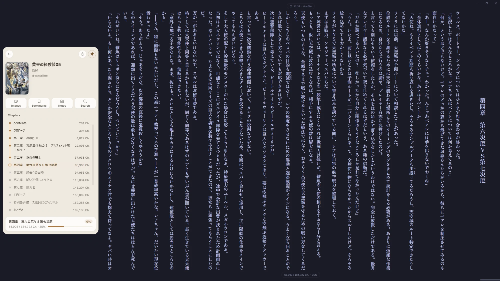
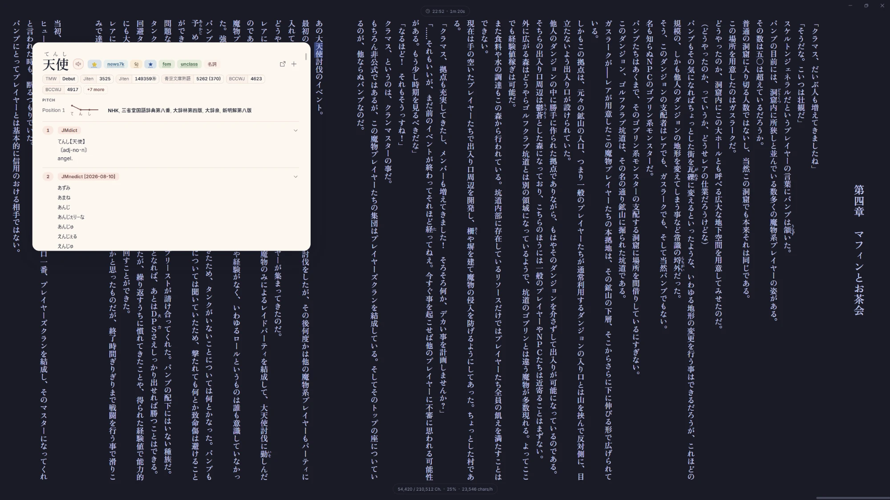
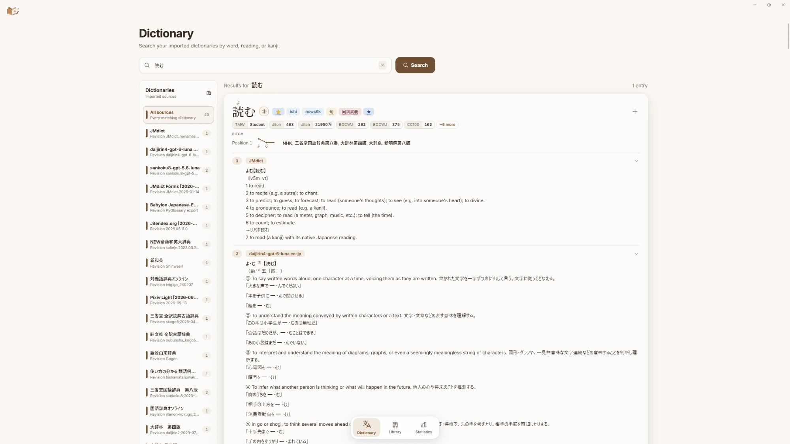
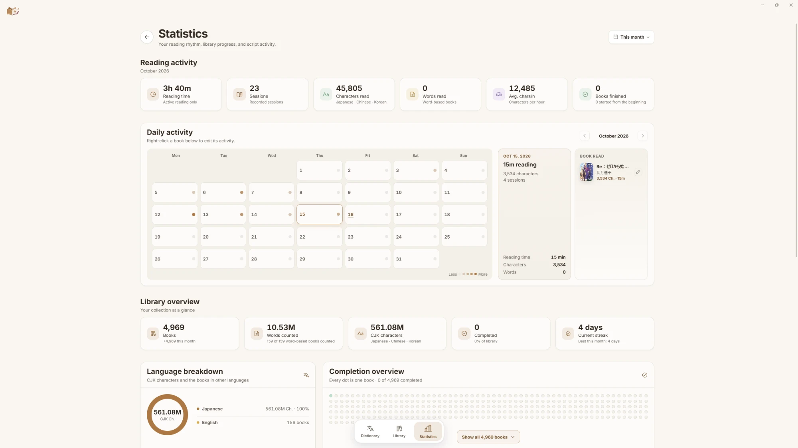
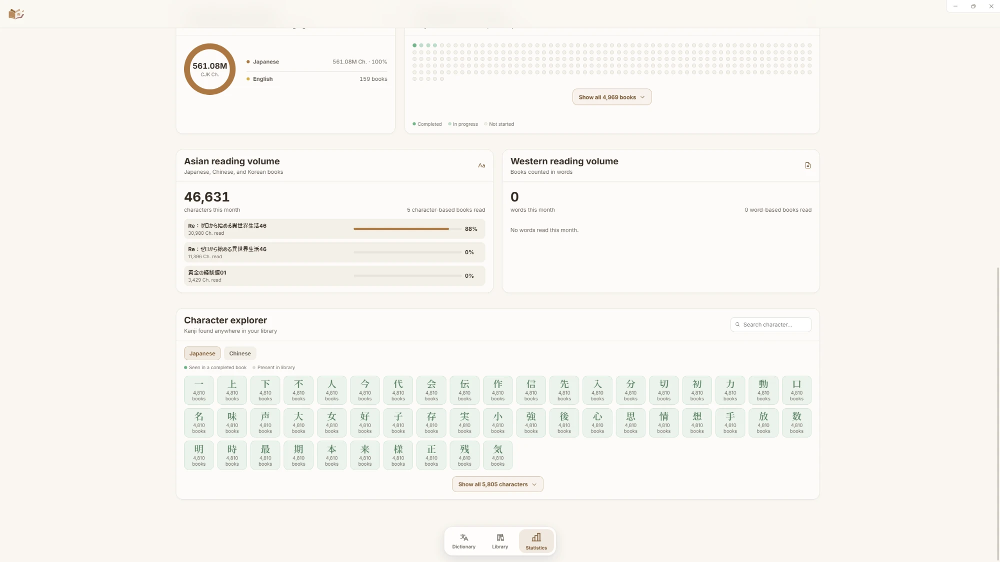
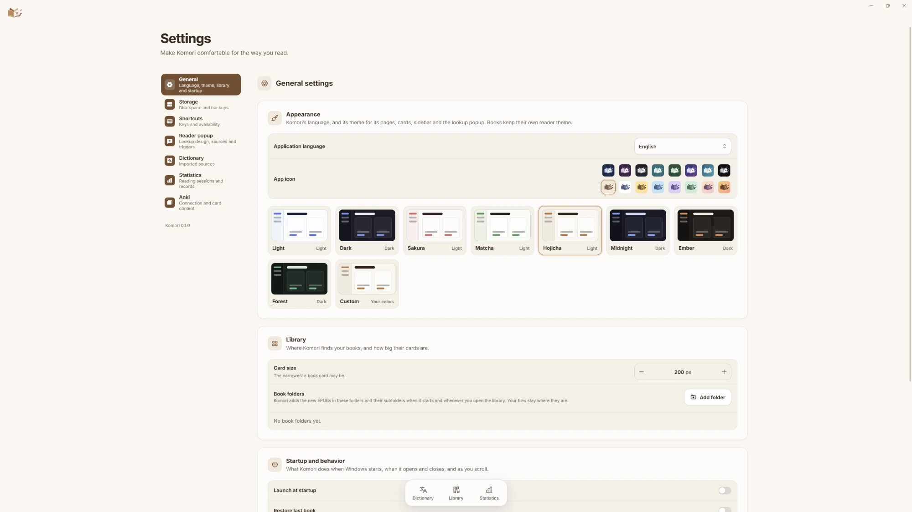

<p align="center">
  
</p>

<h1 align="center">Komori</h1>

<p align="center">
  A lightweight EPUB reader for Windows and Android, for readers and language learners, with
  pop-up dictionary lookup, reading statistics and one-click Anki cards.
</p>

<p align="center">
  
  
  
  
  
  
  
  
  
  
  
  
  
  
  
  
  <br>
  <sub>Sixteen app icons to choose from in Settings.</sub>
</p>

## Screenshots

<!-- To be replaced with screenshots of a public-domain book and the starter dictionaries. -->

| Library                                                        | Reader                                                       | Lookup popup                                                             | Dictionary                                                           |
| -------------------------------------------------------------- | ------------------------------------------------------------ | ------------------------------------------------------------------------ | -------------------------------------------------------------------- |
|  |  |  |  |

| Statistics                                                           | Kanji grid                                                           | Settings                                                         |
| -------------------------------------------------------------------- | -------------------------------------------------------------------- | ---------------------------------------------------------------- |
|  |  |  |

## Features

- **Library.** Your EPUBs with real covers and progress, continue reading, grid and list
  views, search, filters, sorting by title, author and more, and groups by series, language
  or author. Book folders and drag and drop from Explorer import even messy collections,
  reading volumes and series from file names, and moved files can be relinked. Fix any title
  or author for one book or many at once: retitle the first volume and the rest follow,
  numbered. Komori reads your files where they are and never changes them.
- **Reader.** Continuous, semi-continuous, paginated and visual-novel modes; horizontal or
  vertical writing; detailed typography with downloadable and imported fonts, each script in
  a font that can show it; fifteen themes plus your own and a background image; furigana
  hiding; bookmarks, notes and highlights; find in book; an image gallery; middle-click
  autoscroll; and a configurable footer with position, clock and reading speed.
- **Lookup in ten languages.** Look words up in Japanese, English, Spanish, French,
  Portuguese, Italian, German, Russian, Korean or Chinese books with Shift, a shortcut,
  selection, click or hover. Each language has its own dictionaries, deinflection and word
  audio. Readings with furigana, IPA, pitch accent, frequency, tags, kanji cards and nested
  lookups.
- **Dictionary.** A full dictionary page with the same results, sources in your order and
  a kanji card for single characters.
- **Statistics.** Characters (or words) read, time, speed, an activity calendar with
  editable days, library overview and a character explorer. Recording pauses while
  Komori's window is in the background.
- **Anki.** Configure once in Settings, then create a card with one click from the popup,
  with the reading, definitions, frequency, word audio and book cover, in a deck for each
  lookup language. The Lapis note type is bundled.
- **Discord.** If you turn it on, your Discord status shows the book you're reading and your
  progress, or which part of Komori you're using.
- **On your phone too.** The Android app has the same Library, Reader, lookup, Dictionary and
  Statistics, made for touch, and adds words to AnkiDroid. Connect it to Komori on your PC to
  read the PC's books on the phone and keep positions, bookmarks, notes and statistics in step.
- **At home on Windows.** Application themes, sixteen app icons, launch at startup,
  minimize to the tray, reopen the last book and remember the window's place.
- **Your data stays yours.** Automatic snapshots, backup export and import, signed
  updates you approve, and no telemetry. The interface is available in English, Japanese,
  Simplified and Traditional Chinese, Korean, German, Spanish, French, Italian, Brazilian
  Portuguese and Russian.

## Install

### Windows

1. Download the latest `Komori_<version>_x64-setup.exe` from the
   [Releases](https://github.com/Yuu-4chan/komori/releases) page.
2. Run it. The installer is not code-signed, so Windows SmartScreen may warn about an
   unknown publisher; choose **More info**, then **Run anyway**.

Komori checks for new versions when it starts and asks before installing one, showing what
changed. To uninstall, use **Installed apps** in Windows Settings; the uninstaller asks
whether to delete Komori's data as well.

Komori runs on 64-bit Windows 10 and 11 and needs the Microsoft Edge WebView2 Runtime, which
Windows 11 already includes; if it is missing, the installer downloads and installs it.

### Android

1. On the phone, download the latest `Komori_<version>_android-arm64.apk` from the
   [Releases](https://github.com/Yuu-4chan/komori/releases) page.
2. Open it and allow your browser or file manager to install apps when Android asks.

Komori runs on 64-bit Android 10 and later. It does not update itself: install a newer APK
over it the same way, which keeps your data. To read your PC's books on the phone, turn on
**Allow phones to connect** in Komori's **Settings > Integrations > Devices** on the PC, then
enter the address and code it shows in **Settings > Sync** on the phone; both must be on the
same network.

## Dictionaries

Komori looks words up in one lookup language at a time, chosen in **Settings > Dictionary**,
and each language keeps its own dictionaries. When a language has none, Komori offers to
download freely licensed ones: Wiktionary dictionaries with definitions in your language
and IPA pronunciations for every lookup language, and for Japanese also curated
Japanese–English dictionaries, a word frequency list, a kanji dictionary and a proper-name
dictionary. You can also import any dictionary ZIP archive in the format used by popular
pop-up dictionary extensions (an `index.json` in format 2 or 3): choose **Add dictionaries**
and pick one or more ZIP files. Komori copies the entries into its own store and never
changes the archive. Drag the rows to set the lookup order. You can also use Komori freely
without any dictionary.

## Privacy

Komori has no account, telemetry or analytics. Your library, reading history, notes and
dictionaries stay in `%APPDATA%\app.komori.reader` on your computer. It uses the network
only to check for updates (which you can turn off), to fetch word audio when you ask for it,
and to download starter dictionaries or the Reader fonts you choose. It talks to Anki, and to
Discord when you turn on the Discord status, only on your own computer. On Android, the same
data stays in Komori's private app storage, and the phone talks to your PC only over your own
network, after you connect them. See [docs/privacy.md](docs/privacy.md) for details.

## Build from source

### Prerequisites

| Tool                                                                                                                      | Tested version                           |
| ------------------------------------------------------------------------------------------------------------------------- | ---------------------------------------- |
| Windows 10 or 11, 64-bit                                                                                                  | Windows 11 Pro                           |
| [Visual Studio Build Tools](https://visualstudio.microsoft.com/visual-cpp-build-tools/) with Desktop development with C++ | 2022 (17.14.40)                          |
| [Microsoft Edge WebView2 Runtime](https://developer.microsoft.com/microsoft-edge/webview2/)                               | 155.0.4283.45                            |
| [Rust](https://rustup.rs/) (MSVC toolchain)                                                                               | 1.98.1 (`stable-x86_64-pc-windows-msvc`) |
| [Node.js](https://nodejs.org/)                                                                                            | 26.12.1                                  |
| [pnpm](https://pnpm.io/)                                                                                                  | 11.19.0 (pinned in `package.json`)       |

See the [Tauri prerequisites](https://v2.tauri.app/start/prerequisites/) for more on the
Windows toolchain.

### Build and run

```bash
git clone https://github.com/Yuu-4chan/komori.git
cd komori
pnpm install
pnpm tauri:dev
```

`pnpm tauri:dev` runs Komori with live reload. To build the release executable and
installer:

```bash
pnpm tauri:build
```

The executable is `src-tauri/target/release/komori.exe`, and the installer is in
`src-tauri/target/release/bundle/nsis/`. It includes `LICENSE`, `NOTICE` and
`THIRD-PARTY-NOTICES.txt`. The first release build downloads Tauri's NSIS bundling tools.

Published releases are built by the Release workflow with `pnpm tauri:release`, which also
signs the installer for the updater and writes `latest.json`; see
[docs/release-checklist.md](docs/release-checklist.md).

The Android app builds with `pnpm android:build` (debug APKs for arm64 phones and the x86_64
emulator); it needs Android Studio's SDK with NDK 29 and the Rust targets
`aarch64-linux-android` and `x86_64-linux-android`.

`pnpm validate:full` runs formatting, lint, type, frontend and Rust checks and tests. More in
[docs/workflow.md](docs/workflow.md); the [docs](docs/README.md) describe the architecture.

## Troubleshooting

See [docs/troubleshooting.md](docs/troubleshooting.md).

## Special Thanks

I learned a lot from and was inspired by these projects, they're all worth checking out:

- [learnjapanese.moe](https://learnjapanese.moe) — a guide to learning Japanese through
  immersion, and its community.
- [Yomitan](https://github.com/yomidevs/yomitan) — the pop-up dictionary browser extension
  that shaped how Komori looks words up.
- [ッツ Ebook Reader](https://github.com/ttu-ttu/ebook-reader) — a browser EPUB reader for
  Japanese immersion.
- [Yatsu Reader](https://yatsu.moe/) — a browser ebook reader with Japanese, Chinese
  and Korean support.
- [Jiten](https://jiten.moe/) — vocabulary, difficulty and frequency data for Japanese media.
- [Hoshi Reader](https://github.com/Manhhao/Hoshi-Reader) — a Japanese EPUB reader for iOS and other platforms with dictionary lookup.
- [Lapis](https://github.com/donkuri/lapis) — the Anki note type for Japanese sentence mining
  that Komori's cards use.

Komori also builds on many open-source libraries, fonts and dictionaries; see
[ACKNOWLEDGEMENTS.md](ACKNOWLEDGEMENTS.md).

## Contributing

Issues are welcome, but pull requests may not be accepted. To report a security problem,
see [SECURITY.md](SECURITY.md).

## License

Komori is free software under the
[GNU General Public License v3.0 or later](LICENSE). See [NOTICE](NOTICE) for copyright and
third-party notices.
